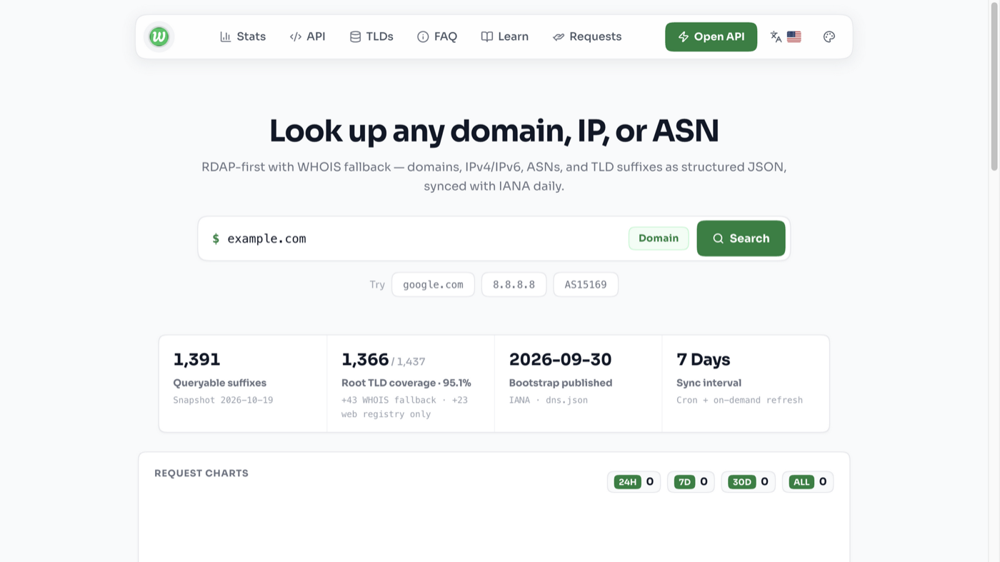
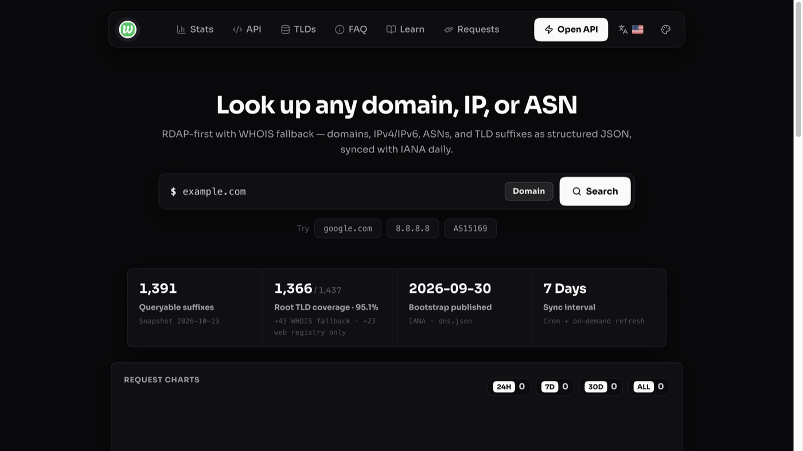
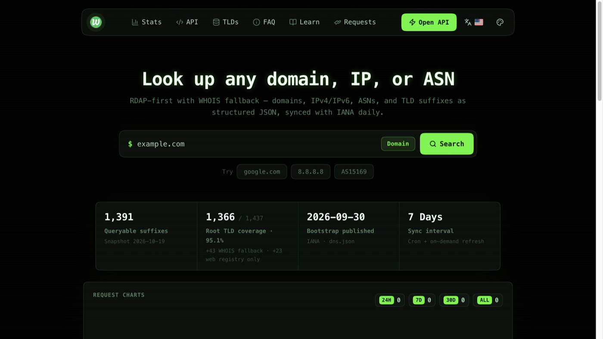

<div align="center">


# Whoga

**Self-hosted domain / IP / ASN lookup — RDAP-first, WHOIS fallback**

<strong>English</strong> · <a href="./README.md">中文</a>

<a href="https://who.ga">who.ga</a> · <a href="https://api.who.ga">api.who.ga</a> · <a href="https://who.ga/learn/en">Guides</a> · <a href="https://github.com/gentpan/whoga/issues">Issues</a>


</div>

<br />

<table>
  <tr>
    <td></td>
    <td></td>
    <td></td>
  </tr>
  <tr>
    <td align="center">Light</td>
    <td align="center">Dark</td>
    <td align="center">Terminal</td>
  </tr>
</table>

## What is this

Type a domain, IP, or ASN and get structured registry + registrar data in one response. RDAP first; when a TLD has no RDAP, it falls back to WHOIS port43 (hostname probing + IANA referral chasing), then to third-party HTTP WHOIS APIs. Covers **95%+ of the IANA root zone** (1,380+ suffixes), with data synced from IANA daily.

The UI ships with three switchable themes (light / dark / terminal), squircle corners, and bilingual copy (English / 中文). A public JSON API is included, and self-hosting needs just one process.

## Quick start

```bash
git clone https://github.com/gentpan/whoga.git
cd whoga
pnpm install
pnpm dev          # http://localhost:3410
```

Production:

```bash
pnpm build && pnpm start
```

## API

```bash
curl "http://localhost:3410/api/whois?domain=google.com"
curl "http://localhost:3410/api/whois?domain=8.8.8.8"
curl "http://localhost:3410/api/whois?domain=AS15169"
```

The hosted API also accepts path-style calls: [api.who.ga/google.com](https://api.who.ga/google.com)

## Stack

**The backend is not Go — there is no separate backend at all.** This is a single-repository TypeScript full-stack app: the web UI and the JSON API run in the same Node.js process, with one build and one deploy.

| Layer | Details |
|-------|---------|
| Language | TypeScript end to end |
| Runtime | Node.js 20+ · pnpm |
| Framework | TanStack Start (SSR) + Nitro (server) |
| Frontend | React 19 · Vite · TanStack Router (file-based routes) |
| UI | Base UI · Lucide icons |
| Styling | Plain CSS variables + theme system · `corner-shape: squircle` (graceful fallback) |
| API | Nitro handlers in `api/`, same process as the pages |
| Cache | Redis (optional) |

## Configuration

```bash
cp .env.example .env
```

| Variable | Description |
|----------|-------------|
| `CRON_SECRET` | Secret for the refresh endpoint (recommended in production) |
| `REDIS_URL` | Redis cache |
| `WHOIS_CACHE_TTL_SECONDS` | Cache TTL, default 900 |

## Data

`data/` (seed) → `runtime/data/` (runtime, takes precedence). Refresh:

```bash
pnpm refresh:data               # full refresh (or POST /api/admin/refresh)
pnpm sync:rdap-extra            # regenerate supplementary RDAP mappings
pnpm scan:whois-hosts           # probe WHOIS hosts for suffixes without RDAP
pnpm test:rdap-all              # live-test every suffix's RDAP endpoint
pnpm check:tlds-queryability    # suffix coverage report
```

## Project layout

```
whoga/
├── web/           # frontend: routes/ · components/ · lib/ (copy & logic)
├── api/           # HTTP API handlers (/api/whois, /api/stats, ...)
├── lib/           # shared logic (RDAP/WHOIS, data index, fallback chain)
├── data/          # seed data (RDAP mappings, TLD lists)
├── runtime/       # runtime data (gitignored, takes precedence)
├── scripts/       # data refresh & ops scripts
├── deploy/        # deployment scripts (see deploy/README.md)
└── docs/          # screenshots and doc assets
```

## Deployment

```bash
./deploy/deploy-caddy.sh ~/.ssh/your-key.pem
```

See [deploy/README.md](./deploy/README.md) for details.

---

<div align="center">

<sub>Whoga · Self-hosted RDAP & WHOIS · MIT License</sub>

</div>
